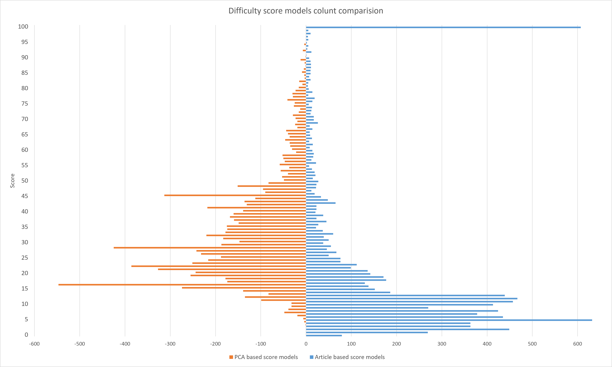

# BESSER-Dataset — Difficulty Score Report

*Generated 2026-09-17. Compares two per-model structural difficulty scores computed
over all 9,082 BUML models: a PCA-based score built for this dataset, and a
reproduction of a reference paper's linear formula. Source data:
`reports/difficulty_score_report.json`, `reports/difficulty_score_article_report.json`,
`reports/difficulty_score_comparison_report.json`; methodology notes:
`docs/DECISIONS.md` (2026-09-17 entries). Both scores are written per-model into every
`model_metadata.json`.*

## At a glance

| | PCA score (`difficulty_score`) | Article-formula score (`difficulty_score_article`) |
|---|---|---|
| Structural fields used | **11** (all non-constant structural counts) | **3** (classes, relationships, attributes) |
| Field weights | Learned from the data (PCA loadings) | Fixed by the paper (0.3571 / 0.4082 / 0.2347) |
| Handles outliers | Yes — log1p + standardization | No — linear in raw counts |
| Captures enumerations / methods / type diversity / multiplicity | Yes | No |
| Output range | Bounded, `[0, 100]` by construction | Unbounded (`[0.00, 931.36]` observed) |
| Determinism | Yes (`numpy.linalg.eigh`, no randomness) | Yes (closed-form) |

**Agreement between the two:** Pearson (linear) `r = +0.731`, Spearman (rank)
`ρ = +0.894`, top-10%-hardest overlap `75.6%` (686/908). The two broadly agree — but
where they disagree, it is systematic, not noise, and traces directly back to what
the article formula's 3 fixed variables cannot see (below).

---

## 1. Why two scores, and what each is trying to measure

Reference paper: Cheng, Y.; Huang, Y.; Yao, S.; Qian, Y.; Zhang, L.; Fang, X.; Wu, T.
"Large Language Models for UML Class Diagram Modeling: A Preliminary Empirical
Evaluation." *Applied Sciences* 2026, 16(13), 6540.
[10.3390/app16136540](https://doi.org/10.3390/app16136540).

A reference paper scores model difficulty as
`D = w_c*C + w_r*R + w_a*A + w_fk*FK`, where `C` = class count, `R` = relationship
complexity, `A` = attribute count, and `FK` = Flesch-Kincaid readability of the
natural-language requirement text. The paper's own weights are
`(0.35, 0.40, 0.23, 0.02)` — `FK`'s weight is small enough to be dropped, and the
rest rescaled to sum to 1: `w_c=0.3571, w_r=0.4082, w_a=0.2347`.

This dataset has no natural-language requirement text to compute `FK` from (models
are generated from BUML directly), so only the structural part is reproducible here.
Rather than assume the paper's fixed weights and 3 variables are the right lens for
*this* dataset, a second, independent score was built: a PCA-based score that starts
from every structural field this dataset actually has (11 fields, not 3) and lets the
data itself decide which fields matter and by how much, rather than hand-picking
which types of structure count toward "difficulty."

---

## 2. The PCA-based score (`difficulty_score`) — full method, with real numbers

### 2.1 What PCA is actually doing, in plain terms

Picture every one of the 9,082 models as a single dot in an **11-dimensional
space** — one axis per structural field (how many classes it has, how many
attributes, how many associations, and so on). Most of those 11 numbers move
together: a model with more classes usually also has more attributes, more
relationships, more of everything. That shared movement means the cloud of
9,082 dots isn't a random blob — it's stretched out along certain directions
far more than others.

**PCA finds those directions mathematically**, in order of how much the cloud
is stretched along each one:

- **PC1** is the *single straight line* through the 11-dimensional cloud
  along which the dots are the most spread out. It's the one combination of
  the 11 fields that best separates "small, simple models" from "large,
  elaborate models."
- **PC2** is the *next* most-spread-out direction — but only counting spread
  that's independent (statistically uncorrelated) of PC1. It captures a
  *different* kind of variation that PC1's "how big" axis doesn't explain.
- This continues for as many directions as there are input fields — **11
  components total, PC1 through PC11** — each capturing strictly less of the
  remaining spread than the one before it.

A **"loading"** is just a weight: PC1 is a weighted sum of the 11
(standardized) fields, and the loadings are exactly those weights. A field
with a large loading on PC1 matters a lot for "how big" a model is; a field
with a near-zero loading barely matters for that particular direction.

### 2.2 Step 1 — put every field on the same scale before comparing them

Raw counts can't be compared directly: a model with 900 classes and a model
with 3 attribute types aren't on the same scale, and PCA would just declare
"classes" the most important field purely because its numbers are bigger. Two
transforms fix this, applied to each of the 11 fields independently:

**(a) `log1p`** — replace every raw count `x` with `ln(1 + x)`. This
compresses extreme values (a few models have thousands of classes; most have
a dozen) while still preserving their relative order — a 900-class model
still logs out bigger than a 90-class one, just not 10× bigger anymore.

**(b) Standardize (z-score)** — after the log transform, subtract that
field's own mean and divide by its own standard deviation, both computed
**across all 9,082 models**:

```
z = ( log1p(raw_count) − mean_of_log1p_across_dataset ) / std_of_log1p_across_dataset
```

After this, every field has mean 0 and spread 1 — so PCA judges each field by
how much models genuinely *differ* on it, not by how large its raw numbers
happen to be. These means/stds are the dataset-wide constants baked into the
formula (from `reports/difficulty_score_report.json`):

| Field | log1p mean | log1p std |
|---|---:|---:|
| classes | 2.6624 | 1.0579 |
| attributes | 2.1872 | 1.1660 |
| associations | 1.6824 | 1.1088 |
| composition | 1.2394 | 1.3613 |
| generalizations | 1.2342 | 1.5525 |
| abstract_classes | 0.6414 | 0.9352 |
| enumerations | 0.3715 | 0.6419 |
| enumeration_literals | 0.5482 | 1.0922 |
| methods | 0.2578 | 0.8298 |
| many_valued_association_ends | 1.5989 | 1.1020 |
| attribute_type_diversity | 1.0706 | 0.5084 |

Three more fields exist in `model_metadata.json` (`association_classes`,
`abstract_methods`, `aggregation`) but are **excluded entirely**: they're
confirmed true constants (every model has the exact same value, so
std = 0) across all 9,082 models. Standardizing a constant means dividing by
zero, so this isn't a judgment call about relevance — it's a mathematical
requirement.

### 2.3 Step 2 — PCA itself: eigenvectors and the two components we use

Once all 11 fields are standardized, PCA computes their **correlation
matrix** (an 11×11 table of how strongly every pair of fields moves
together) and finds its **eigenvectors** — the "stretch directions"
described in 2.1 — via `numpy.linalg.eigh`, a deterministic, no-randomness
algorithm (the same inputs always produce the exact same output, unlike some
other PCA implementations that use randomized approximations). Each
eigenvector comes with an **eigenvalue**, which is exactly "how much of the
cloud's total spread this direction accounts for" — sorted largest to
smallest, eigenvector #1 is PC1, #2 is PC2, and so on.

A model's **raw score on a component** is a dot product — multiply each
field's z-score by that component's loading for that field, and add them all
up:

```
PC1_raw = Σ (PC1_loading_i × z_i)     for each of the 11 fields i
PC2_raw = Σ (PC2_loading_i × z_i)
```

**Full PC1 and PC2 loadings** (every one of the 11 weights, exactly as
computed):

| Field | PC1 loading | PC2 loading |
|---|---:|---:|
| classes | +0.3576 | −0.0471 |
| attributes | +0.2896 | +0.4831 |
| associations | +0.2751 | +0.2400 |
| composition | +0.3395 | −0.2514 |
| generalizations | +0.3488 | −0.3189 |
| abstract_classes | +0.3142 | −0.2567 |
| enumerations | +0.3063 | +0.1275 |
| enumeration_literals | +0.3262 | −0.0599 |
| methods | +0.2019 | −0.0795 |
| many_valued_association_ends | +0.3468 | +0.0017 |
| attribute_type_diversity | +0.1254 | +0.6707 |

Reading this table is the whole story: **every single PC1 loading is
positive** (0.13 to 0.36) — there's no field that pulls PC1 down, so "higher
PC1 = more structure, period" is a safe, literal reading. **PC2's loadings
have mixed signs** — `attribute_type_diversity` (+0.671) and `attributes`
(+0.483) pull one way; `generalizations` (−0.319), `abstract_classes`
(−0.257), and `composition` (−0.251) pull the other. That's PC2's real
content: a *contrast* between data-schema-heavy models (lots of different
attribute types) and hierarchy-heavy models (lots of inheritance), not a
second "bigness" scale.

### 2.4 What all 11 components look like

PCA always produces as many components as input fields — here's every one of
them, with how much of the dataset's total variation each explains (from the
same PCA run; only PC1 and PC2 are actually used in the final score, see
2.5, but the full picture shows why the other 9 were left out):

| Component | Variance explained | Cumulative | Dominant fields (largest loadings) |
|---|---:|---:|---|
| PC1 | 48.54% | 48.54% | Every field positive — overall size/richness |
| PC2 | 14.80% | 63.34% | `attribute_type_diversity`/`attributes` (+) vs. `generalizations`/`abstract_classes`/`composition` (−) — data-schema-heavy vs. hierarchy-heavy style |
| PC3 | 9.87% | 73.21% | `enumerations`/`enumeration_literals` (−) vs. `associations` (+) |
| PC4 | 7.47% | 80.67% | `methods` (+0.89, dominates almost alone) |
| PC5 | 5.90% | 86.58% | `associations` (−) vs. `attribute_type_diversity`/`generalizations` (+) |
| PC6 | 4.93% | 91.51% | `composition` (+) vs. `abstract_classes` (−) |
| PC7 | 3.34% | 94.85% | `abstract_classes` (+) vs. `classes` (−) |
| PC8 | 2.00% | 96.85% | `attributes` (−) vs. `attribute_type_diversity` (+) |
| PC9 | 1.38% | 98.23% | `many_valued_association_ends` (−) vs. `associations` (+) |
| PC10 | 0.95% | 99.18% | `generalizations` (−) vs. `composition` (+) |
| PC11 | 0.82% | 100.00% | `enumeration_literals` (+) vs. `enumerations` (−), the last leftover contrast |

**Why stop at PC1+PC2 and not use more?** Two reasons. First, the drop-off is
steep and then flattens: PC1+PC2 already capture 63.34% of all variation,
while every component from PC3 onward explains under 10% each, trailing off
gradually with no further sharp break. Second, and more importantly, PC2 was
only included after being **empirically checked**, not just because it was
next in line: its two extremes were confirmed to both be large, substantial
models (see 2.1) rather than one being a trivial/small-model artifact. PC3
onward were not put through that same verification, so folding any of them
into the score would mean trusting an unverified axis — the two-component
design is a deliberate stopping point, not a limitation of the method itself.

### 2.5 Step 3 — turning PC1 and `|PC2|` into a bounded 0–100 score

Three things happen here, in order:

**(a) PC2 is folded in as an absolute value, `|PC2|`, not its signed value —
this is a mathematical requirement, not a style choice.** Whenever an
eigenvector's loadings don't all share one sign (PC2's case exactly), the
sign of the whole component is arbitrary — the eigendecomposition math is
equally valid flipped. Using the signed value would make the score depend on
an arbitrary coin-flip with zero connection to the actual models. `|PC2|`
reads as "how far this model leans toward *either* extreme style," which is
the only sign-independent, meaningful reading.

**(b) The 100 points are split between PC1 and PC2 in proportion to how much
variance each explains** — not an even 50/50 split:

```
PC1_budget = 100 × 0.4854 / (0.4854 + 0.1480) = 76.6372 points
PC2_budget = 100 × 0.1480 / (0.4854 + 0.1480) = 23.3628 points
```

This ratio is recomputed from the real eigenvalues every time the script
runs — it is never hand-typed.

**(c) Each component is independently rescaled into its own point budget**
via *percentile-clip, then linear min-max* — this is the literal mechanism
for "how do we spread the score from 0 to 100":

```
lo, hi  = 1st percentile, 99th percentile of that component's raw scores
          (computed separately for PC1 and for |PC2|)
clipped = clip(raw_score, lo, hi)      # values beyond the 1st/99th percentile
                                        # are pulled in to lo/hi, not dropped
points  = (clipped − lo) / (hi − lo) × budget
```

The actual clip bounds and budgets from the full 9,082-model run:

| Component | 1st percentile (`lo`) | 99th percentile (`hi`) | Point budget |
|---|---:|---:|---:|
| PC1 (signed) | −3.4620 | +7.3262 | 76.6372 |
| `\|PC2\|` (unsigned) | 0.0041 | 3.0209 | 23.3628 |

Percentile-clipping (rather than plain min-max on the true min/max) means
only the most extreme ~1% of models on each side get pulled to the boundary
— everyone else is spread linearly across the full budget without a handful
of outliers compressing the rest of the scale. Finally:

```
difficulty_score = PC1_points + PC2_points
```

Since each addend is already clipped to `[0, its own budget]`, the sum is
mathematically guaranteed to land in `[0, 100]` — there is no separate
clamping step at the end because none is needed.

### 2.6 A complete worked example: `model_2023`, start to finish

`model_2023` (the 932-class fUML trace metamodel used in Section 5's
outlier discussion) makes a good worked example precisely because it's an
extreme case. Its 11 raw counts, straight from `model_metadata.json`:

| Field | Raw count | log1p | z-score | ×PC1 loading | ×PC2 loading |
|---|---:|---:|---:|---:|---:|
| classes | 932 | 6.8384 | 3.9473 | 1.4115 | −0.1860 |
| attributes | 11 | 2.4849 | 0.2553 | 0.0739 | 0.1233 |
| associations | 836 | 6.7298 | 4.5522 | 1.2523 | 1.0925 |
| composition | 292 | 5.6802 | 3.2622 | 1.1077 | −0.8202 |
| generalizations | 332 | 5.8081 | 2.9462 | 1.0275 | −0.9396 |
| abstract_classes | 70 | 4.2627 | 3.8723 | 1.2167 | −0.9939 |
| enumerations | 0 | 0.0000 | −0.5787 | −0.1772 | −0.0738 |
| enumeration_literals | 0 | 0.0000 | −0.5019 | −0.1637 | 0.0300 |
| methods | 0 | 0.0000 | −0.3106 | −0.0627 | 0.0247 |
| many_valued_association_ends | 661 | 6.4953 | 4.4432 | 1.5408 | 0.0077 |
| attribute_type_diversity | 3 | 1.3863 | 0.6210 | 0.0779 | 0.4166 |
| **Sum (= PC1_raw / PC2_raw)** | | | | **7.3047** | **−1.3186** |

Now apply the Step 3 rescale to each sum:

- **PC1:** raw = 7.3047. Clip bounds are [−3.4620, 7.3262] — 7.3047 is just
  barely *inside* the upper bound (this model sits right at the edge of the
  top 1%, but isn't clipped). Points = `(7.3047 − (−3.4620)) / (7.3262 −
  (−3.4620)) × 76.6372` = **76.4841**.
- **PC2:** raw = −1.3186, so `|PC2|` = 1.3186. Clip bounds are [0.0041,
  3.0209] — well inside, no clipping. Points = `(1.3186 − 0.0041) / (3.0209
  − 0.0041) × 23.3628` = **10.1797**.
- **Final score:** `76.4841 + 10.1797` = **86.6638**.

This matches `model_2023`'s actual stored `model_metadata.json` values
exactly (`difficulty_score = 86.6638227309274`,
`difficulty_score_pc1_points = 76.4840892138438`,
`difficulty_score_pc2_points = 10.179733517083594`) — the table above is not
a simplified illustration, it's the literal arithmetic the script performs,
reproduced by hand and cross-checked digit-for-digit.

### 2.7 Result

`difficulty_score` written for 9,082/9,082 models. Observed range
`[3.27, 93.55]`.

---

## 3. The article-formula score (`difficulty_score_article`)

`D = 0.3571*C + 0.4082*R + 0.2347*A`, applied directly to raw counts — no
standardization, no outlier dampening. `C = classes`, `A = attributes`, and
`R = associations + aggregation + composition + generalizations` (every separate
relationship type in this dataset's metamodel, counted once each; a paper-specified
`dependency` term is omitted since no `Dependency` class appears anywhere in this
dataset's BUML models).

**Result:** `difficulty_score_article` written for 9,082/9,082 models. Observed
range `[0.00, 931.36]`, mean `27.88` — unbounded and far more outlier-sensitive than
the PCA score, since nothing dampens a model with an extreme raw class count.

---

## 4. Head-to-head comparison

`scripts/compare_difficulty_scores.py` / `reports/difficulty_score_comparison_report.json`.

- **Pearson correlation:** `+0.731`
- **Spearman correlation:** `+0.894`
- **Top-10% ("hardest") overlap:** 686/908 models (**75.6%**)

The gap between Pearson and Spearman is itself informative: the two scores agree much
more on *ordering* than on raw linear value, which is expected — the article score's
unstandardized linearity makes it far more sensitive to a handful of extreme-count
outliers than the log1p + standardized PCA score is.



Binning both scores onto the same shared 0–100 axis makes the shape difference more
striking still: the article score (right, capped at 100) piles up overwhelmingly in the
0–15 range (400–600+ models per point near the bottom) and only separates the handful
of largest outliers, while the PCA score (left) spreads far more evenly across the full
range with a proper peak around 15–30 — i.e. the PCA score actually differentiates the
bulk of ordinary models, where the article score collapses most of them together.

*(The article score shown in both charts is capped — not rescaled — at 100:
`min(difficulty_score_article, 100)`. Capping only pulls in the small number of models
above 100 while leaving every other model's real value untouched, so the shape of the
bulk of the distribution is preserved for this comparison; the real, unbounded
`difficulty_score_article` value is unchanged in `model_metadata.json` and everywhere
else in this report. See `scripts/export_difficulty_scores_for_excel.py`.)*

### Where they disagree, and why

Two concrete cases from the 15 largest rank-percentile disagreements
(full list in the JSON report) show the disagreement is systematic, not random:

**Case A — enumeration-only models are invisible to the article formula.**

| Model | classes | attributes | associations/agg./comp./gen. | enumerations | enum. literals | PCA score (percentile) | Article score (percentile) |
|---|---|---|---|---|---|---|---|
| `model_3616` | 0 | 0 | 0 | 344 | 1,223 | **41.17** (75th) | **0.00** (0.2nd) |

`model_3616` is a pure enumeration model — 344 enumerations, 1,223 literals, nothing
else. `C`, `R`, and `A` are all exactly 0, so the article formula scores it 0
regardless of how large its enumeration structure is. The PCA score includes
`enumerations`/`enumeration_literals` as first-class fields (PC1 loadings +0.306 and
+0.326, comparable in magnitude to `classes`' +0.358) and correctly ranks it in the
75th percentile.

**Case B — raw class count over-rewards wide, structurally uniform models.**

| Model | classes | associations | generalizations | many-valued ends | attribute type diversity | PCA score (percentile) | Article score (percentile) |
|---|---|---|---|---|---|---|---|
| `model_10002872` | 41 | 18 | 0 | 0 | 1 | **15.32** (9.5th) | **22.46** (74.5th) |

41 classes drives `0.3571*41 ≈ 14.6` of the article score by itself — more than half
its total — despite the model having zero inheritance, zero multiplicity richness,
and only one attribute type in use anywhere. The PCA score weighs the raw class count
(log1p-dampened) against the model's near-total absence on every other dimension and
correctly places it near the bottom decile.

Both cases generalize: most of the biggest rank disagreements in the full report
follow one of these two shapes — a model whose complexity is concentrated in a field
the article formula ignores entirely (enumerations, methods, type diversity,
multiplicity), or a model whose raw class/attribute/relationship count is high but
otherwise structurally simple, which the article formula's linearity cannot discount
the way PCA's standardization does.

---

## 5. Why the PCA score is the more accurate measure of difficulty

1. **The article formula produces scores with no interpretable relationship to its own
   difficulty scale once applied to a genuinely large model — confirmed by the paper's
   own text, not an artifact of our reproduction.** Its Section 3.1.2 states explicitly:
   *"We retain original raw-data weighting without normalization, as primitive
   numerical features carry inherent domain semantics for UML difficulty
   evaluation."* The paper's own benchmark is 30 hand-picked textbook exercises
   with class counts of 4–13 and relationship counts of 3–16 (its Table 1) — nothing
   close to this dataset's largest real models. Applied to `model_2023` (a genuine
   932-class fUML trace metamodel: 836 associations, 292 composition, 332
   generalizations, `R = 1460`), the formula gives:

   | Term | Value | Contribution | Share |
   |---|---|---|---|
   | `0.3571 * C` | C=932 | 332.86 | 35.75% |
   | `0.4082 * R` | R=1460 | 595.92 | 63.99% |
   | `0.2347 * A` | A=11 | 2.58 | 0.28% |
   | **Total D** | | **931.36** | |

   The paper's own Table 2 reports its *hard*-tier average as `C=9.6, R=12.0, A=23.8`,
   which recomputes to `D ≈ 13.9` under the same weights. `model_2023` scores **~67×**
   that — not because it is 67× harder in any meaningful sense, but because `R` and `C`
   are raw, unbounded counts and nothing in the formula limits how much a single
   outlier can dominate the total once applied outside the small, uniform scale it was
   calibrated on. The same model scores a bounded, sensible `86.66` under the PCA
   score — near the top of `[0, 100]`, correctly flagged as one of the hardest models,
   but not mathematically disconnected from every other model's score the way `931.36`
   is. This is not a bug in either the paper or our reproduction; it's what happens
   when an unnormalized formula calibrated on 30 small exercises is applied to a
   dataset spanning orders of magnitude more structural variation.
2. **It uses all the structural information this dataset actually has.** The article
   formula was designed around 4 variables chosen for a different dataset with
   requirement-text readability available; applied here, 3 of this dataset's 11
   meaningful structural dimensions (enumerations, methods, type diversity,
   multiplicity) are entirely absent from it, not just down-weighted. The PCA score
   includes all 11 and lets their real, measured contribution (via PCA loadings)
   determine their weight — nothing is assumed to be irrelevant in advance.
3. **Its weights come from this dataset, not a different one.** The article's
   `(0.3571, 0.4082, 0.2347)` weights were fit for the paper's own dataset and
   requirement-text signal; there's no reason to expect them to transfer to a
   BUML-generated dataset with a different structural profile. PCA's loadings are
   derived from this dataset's actual covariance structure every time it's run.
4. **It is robust to outliers by construction.** `log1p` + standardization + a
   percentile-clip rescale bound the score's sensitivity to the dataset's most
   extreme models (some with thousands of classes); the article formula's raw
   linear sum has no such protection, which is visible directly in the Pearson/
   Spearman gap above.
5. **The disagreements are explainable, not arbitrary.** Both worked examples above
   show the PCA score correcting a specific, identifiable blind spot in the article
   formula (enumeration-blindness, raw-count-without-context) rather than just
   producing a different number for unclear reasons — which is what "more accurate"
   should mean in practice, not merely "different."
6. **Still broadly consistent with the article formula (`ρ = 0.894`).** The PCA score
   isn't measuring something unrelated — it agrees with the article formula on
   overall ordering for the large majority of models, and only diverges where the
   article formula's narrower design demonstrably misses real structure.

---

## Source reports

| Report | Scope | Files |
|---|---|---|
| PCA-based difficulty score | 9,082 (full) | `difficulty_score_report.json` |
| Article-formula difficulty score | 9,082 (full) | `difficulty_score_article_report.json` |
| Score comparison | 9,082 (full) | `difficulty_score_comparison_report.json` |
| Model structure metadata (input to both scores) | 9,082 (full) | `model_metadata_report.{json,md}` |

See `docs/DECISIONS.md` (2026-09-17 entries) for the full methodology discussion
behind both scores, including why PC2 is folded in via absolute value, why weights
are variance-proportional rather than an arbitrary split, and why the article
formula's `R` term must sum all four separate relationship-type fields.
